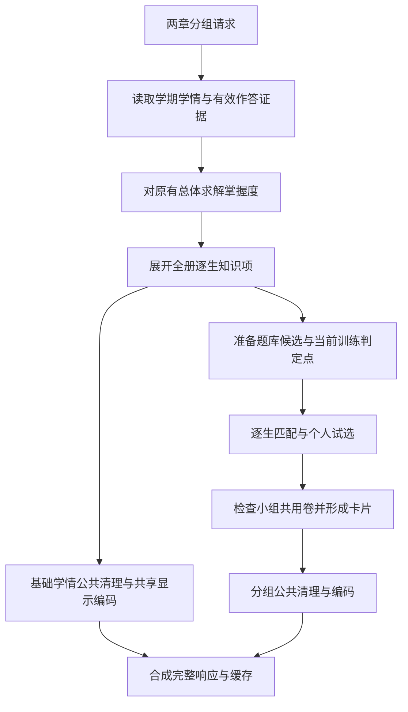

# 首次分组与训练推荐：剩余性能空间及实施交接

日期：2026-10-09。用途：把当前完整计算链路的评价、优化候选、实验依据、实施顺序和验收要求交给其他窗口。本次只调查和测量，没有继续修改业务代码。下文的临时试验不代表正式实现已经完成。

本文接续[已完成的四步优化](training-first-compute-audit-20261009.md)。该轮同输入各 5 次，完整重算中位数为 79.72 → 51.12 秒，结果精确相同。两轮的机器负载和测量时间不同，不把旧基线与本轮临时试验拼成一组速度对照。

## 结论与适用范围

当前完整重算中位数为 **50.17 秒**，仍未达到首次 5 秒。本文列出 **22 项评价条目**：7 组真实输入局部等价对照、其余有代码证据的候选与成本项，并明确排除无收益方案。

建议先实施已经测出收益的选卷覆盖评分、掌握度展开、显示字段复用和单独的批次指纹复用。拟合求值缓存没有命中；素材三项组合反而变慢；Word 大表不直接落地。随后再处理完整值冻结、来源键遍历和有序候选索引。**本次没有证明这些改动合并后能达到 5 秒**，也没有把尚未验证的候选写成预期必得收益。

“学生作答记录不多”不能直接推出当前请求只做少量计算。这个入口同时准备学期学情、全册未测知识项、题库素材、逐生候选、个人试卷和小组共用试卷，最后生成页面响应。剖析显示，很多时间消耗在对同一份资料的反复遍历、解析和评分。

本报告覆盖该请求链路内已观察到的主要热点及次要候选。“全部列出”指本次覆盖范围内的评价清单，不表示已经证明所有方案有收益，也不表示其他册、更多学生和不同机器具有相同耗时。

## 测量范围和口径

| 条件 | 本次范围 |
|---|---|
| 学生和分组范围 | 91 名学生；八上第一章与第二章；12 个结果小组 |
| 学情输出 | 41,830 条逐生知识项；两章限制分组，学情保留该册完整范围及未测节点 |
| 正式入口 | `backend/api/routers/training.py` 的 `build_training_diagnosis`，`response_mode=display_shared` |
| 冷重算 | 每次清空学情、掌握度、候选、匹配、分组、响应及文件解析缓存；关闭持久计算结果的读取与保存 |
| 冷重算的限制 | 操作系统文件缓存没有清空；已有文件摘要缓存允许读取；不等同于机器断电后首次启动 |
| 执行环境 | 同一工作机串行测量；正式应用继续运行；没有重启服务、改端口或重建前端 |
| 数据保护 | 两库原位置只读事务；禁止真实数据文件写入、网络和外部进程；真实输入和完整结果只在内存中比较 |
| 输出材料 | 只保存耗时、次数、规模、代码摘要和完整结果相等判断；不保存学生身份、题面、答卷、逐生结果或内容指纹 |
| 性能计时 | 普通请求与带剖析的请求分开；局部试验前后各 5 次，交替先后顺序，比较工作完成后的完整结果 |

本轮重新测量的 5 次有效冷重算为 **58.61、50.17、48.65、50.05、50.81 秒**。中位数 **50.17 秒**，范围 **48.65～58.61 秒**。每次学情、候选、分组和掌握度拟合均实际执行一次，完整响应逐字相同。

同一进程随后 5 次缓存命中中位数为 **0.119 秒**，范围 **0.103～0.161 秒**。这个时间只包括路由函数，不含 HTTP 和浏览器，不能拿它作为第一次重算的成绩。

5 秒目标相当于在本轮冷重算中位数上再减少约 **90%** 的时间。仅处理某一个数秒级环节不足以达到目标。

本轮完整 cProfile 请求为 154.13 秒、进程 CPU 为 148.88 秒。这个数字包含明显的剖析开销，只用于定位次数和热点。它不是用户应等待的时间，也不是普通速度对照的基线。cProfile 默认主要观察发起线程，工作线程的直接计数由素材专用探针补充。

## 实际链路与互不重复的时间分段

基础学情先编码，随后计算分组并追加到同一响应。图中的分支表示资料去向，不表示两条分支并行运行。

图中“有效作答证据”包括现有规则纳入的选择、填空作答结果，以及解答题可归属到判定点的结果。优化不能把这些输入统一缩成“有效步骤”，也不能只保留失分记录。

在单独一次阶段探针中，完整路由为 **48.19 秒**，完整结果与上述普通样本相同。下列时间互不重复，合计为该次路由时间；它们不是 5 次中位数。

| 阶段 | 扣除已单列子阶段后的时间 | 说明 |
|---|---:|---|
| 学情与证据准备 | 4.15 秒 | 排除掌握度求解与展开 |
| 掌握度拟合 | 4.72 秒 | 真正拟合 1 次 |
| 掌握度结果展开／筛选 | 1.65 秒 | 2 个读取入口共享上述 1 次拟合 |
| 推荐使用的掌握度快照整理 | 3.69 秒 | 排除已单列的掌握度读取；含缓存键、转换等工作 |
| 候选题素材准备 | 11.59 秒 | 真正构建候选快照 1 次 |
| 首次逐生匹配及其缓存键 | 8.75 秒 | 含首次完整值整理，不含后面的选卷 |
| 个人与小组全部选卷 | 6.88 秒 | 176 次调用：个人 87 次、共用 89 次；这是调用次数，不是学生或小组数量 |
| 分组其余工作 | 1.68 秒 | 扣除已单列的匹配、选卷、素材和快照 |
| 公共字段清理 | 1.85 秒 | 学情及分组分别清理 |
| 显示校验与共享响应编码 | 1.18 秒 | 保留完整共享目录和逐生值 |
| 路由、缓存恢复和其他工作 | 2.05 秒 | 未归入以上函数的时间 |
| **合计** | **48.19 秒** | 未计 HTTP、浏览器与应用启动 |

本次候选处理进入 147 次，访问 3,234 个目标，新增 2,184 份目标评估记录。按每次目标数乘合法候选数计算，待检查配对的上界约为 143 万；实际保留候选会更少。选卷入口累计接收 87,594 行候选项，其中包含同一题目跨目标、学生和试选的重复出现。这说明等待主要由工作重复放大，不能按学生数或唯一题目数估计。

阶段包含时间会重叠。例如，选题包含在分组中，Word 解析包含在内容键与判定点派生中。上表使用同一请求的嵌套计时，扣除已单列的子阶段后再分段。后面的 cProfile 数字和局部实验数字不与它相加。

## 临时方案的实际效果

每项前后各 5 次，括号为最小～最大值，单位均为秒。它们是局部普通计时，不含 cProfile；各行的输入边界不同。

| 临时方案 | 基线中位数（范围） | 试验中位数（范围） | 评价 |
|---|---:|---:|---|
| M1：同次选卷覆盖评分复用 | 7.38（6.82～7.86） | 5.01（4.85～6.87） | 176 次选卷的完整题目、顺序和换题审计相同；建议优先实施 |
| D2：掌握度展开固定值提前计算 | 2.65（1.54～2.72） | 1.34（1.32～1.37） | 完整 CurrentMastery 值和顺序相同；不含证据读取与拟合 |
| R1：显示字段集合移出内层循环 | 1.92（1.87～3.04） | 0.81（0.78～1.97） | 完整显示校验与编码字节相同；公共字段清理未绕过 |
| A1：批次内跨线程指纹复用试验 | 18.48（17.09～18.98） | 14.41（13.54～14.96） | 完整素材快照相同；生产版须保留默认线程私有语义 |
| A2：整次素材构建复用 Word 结构 | 21.08（19.72～23.08） | 19.60（18.19～24.70） | 完整快照相同；中位改善较小且有波动，不照搬不限项数大缓存 |
| A1+A2+A4：素材三项组合 | 11.65（11.35～18.33） | 13.70（12.52～18.39） | 完整快照相同，但中位数变慢；不采用这套组合，不能累加单项收益 |
| D1：拟合内完全相同参数求值缓存 | 7.45（6.89～7.70） | 7.69（7.39～8.21） | 结果相同，但命中为 0、没有提速；当前样本不实施 |

普通计时与局部试验发生在不同时间，且保留的内存对象不同。只能使用同一行的前后数据评价该方案，不能把局部节省值直接从完整请求的 50.17 秒中扣除。

求解的 5,582 条观测生成 2,945 个参数。12,917 次损失试探的参数向量全部不同；容量 1、8、16、32、64、128 都没有可省命中。64 项试验仍执行 12,917 次损失和 601 次完整梯度，反而多了制键和存表成本。全部拟合参数、91,766 个协方差元素、每次 364,989 个公开查询和 5,582 个预测均精确相同。这个结果否定的是当前样本的求值缓存收益，不是否定已经完成的“拒绝点不算梯度”。

掌握度展开中的 41,830 条记录，有 39,069 条当前没有纳入观测。试验仍生成全部记录、先验值和区间，只减少空记录的中间对象和相同日期／父链计算。

响应试验仍执行字段清理、类型校验和非有限数检查。正式实现应在本次函数调用内读取一次字段集合，不增加另一套响应模式。

另有成本测量，尚未形成等价改造：完整匹配签名冻结中位数 2.76 秒，其中学情部分 1.37 秒、掌握度部分 0.99 秒、候选部分 0.17 秒；这些拆项与总项不相加。最终请求内目标记录序列化为 28,161,544 字节，dumps 约 1.00 秒、loads 约 0.47 秒，deepcopy 约 8.12 秒。该对象不是缓存存入当刻的精确载荷，不能据此直接计算缓存节省量。

对不含分组的基础共享响应，JSON 编码约 0.026 秒、gzip 约 0.019 秒、解压约 0.007 秒，均为 5 次中位数；基础编码为 2,366,177 字节，压缩缓存为 244,756 字节。这不是完整响应的网络传输测量。先优化上游对象准备，不优先更换 JSON 或压缩库。

Word 单项试验留存 7,371 组精确输入，命中 7,745 次，输入字符总量为 26,897,211。字符数量不等于内存字节数；解析对象峰值和并发请求峰值尚未测。组合试验的完整计数见匿名明细。

Word 单项中位数约改善 7%，但样本范围明显重叠，且某一对试验变慢。这个证据不足以推荐扩大长期全局缓存；先在现有 64 题批次内有界复用，并把输入键和解析结果都计入内存预算。记录中的命中数取第一样本，其余样本计数见明细。

组合试验中 Word 命中降为 307 次，但仍保留同样的 26,897,211 个输入字符；档案复用命中 499 题次。指纹复用已消掉大部分重复解析后，第二层大表仍有复制和存表成本。这解释了为什么需要组合实测。当前组合不进入实施清单；A4 的单项净收益没有单独证明。

以下边界适用于全部临时方案：

- 正式选题、分组、难度、近期原题排除和掌握度规则没有改变。没有通过减少工作范围来获得速度。
- 求解试验保留 600 轮迭代上限、40 次线搜索上限、接受与停止条件、浮点运算顺序和区间计算。
- 选卷试验保留一题与两题交换、36 个交换候选上限、8,000 次双题检查上限以及完整换题审计。
- 素材共享试验只用于测量可省工作。跨线程共享表和不限项数的 Word 备忘表都不能直接当成生产实现。
- 各方案的节省时间不能相加。它们可能消除同一批重复工作；组合后的完整请求必须另测。

## 剩余候选总表

状态：**E**＝已有临时内存实验，实测结果见上一节；**C**＝代码及剖析支持，未证明 A/B 收益；**B**＝只测成本，尚无推荐结构；**X**＝当前输入已测无可省重复。所有项均未实施。测试代号见下节。

素材专用探针补充了工作线程计数：499 道加载输入、483 道最终候选、1,331 条关系；内容指纹实际计算 992 次；完整复用键生成 2,974 次。Word 请求 15,116 次，实际解析 14,984 次，只有 7,371 组不同的 `(xml, plain_text)`。本次超过 64 Ki 字符旁路阈值的请求为 0。专用探针与整页 cProfile 的线程覆盖和缓存调度不同，所以不把 992 与 cProfile 的 991 当作结果变化。

保存档案共请求 1,833 题次，覆盖 1,334 道不同题，其中 499 题次重复。JSON 解码 14,527 次、不同载荷 7,859 份。题次包含同一道题的再次读取，不代表题库存在 1,833 道不同题。JSON 数量差只证明有重复输入，不等于都值得增加缓存。

| ID / 状态 | 当前重复工作与现有复用入口 | 实施条件、主要风险 | 测试 |
|---|---|---|---|
| A1 / E | `analysis.py:2748` 批次指纹缓存为线程私有；加载线程算过的值回主线程可能再算。复用 `source_content_hash_reuse` 与现有加载器。 | 保留默认线程私有；结束批次后显式转交成功的完整键和值。不能按题号或地址相信旧值。失败不缓存，有界并退出释放。 | T1 |
| A2 / E | `analysis.py:2655` Word 缓存仅 128 项；专用探针中 15,116 次请求发生 14,984 次解析。复用现有解析入口。 | 按批次有界复用，保留 XML、plain_text、公式、表格和副本隔离。单项收益有波动，当前三项组合变慢，不直接扩大全局缓存。 | T1 |
| A3 / C | `analysis.py:2781` 完整来源键仍生成 2,974 次；命中前也遍历素材。复用批次输入。 | A1/A2 后再测。仅对加载器拥有、未外泄的输入携带已生成规范值；公开可变对象仍按当前值检查。 | T1 |
| A4 / E（仅组合） | `personalized.py:3590,3760` 初筛与素材加载后再次读取保存档案。复用第一次 `profiles`。 | 当前三项组合没有提速，单项净收益未证实。固定事务实验不证明并行写入安全；明确提交代数。教师批准、拒绝、难度更新必须失效，显式来源验证保留。 | T2 |
| A5 / C | `versioning.py:1363` 保存证据重建、派生判定点和完整表示往返。复用已读证据。 | A1/A2/A3 后只测残余。保持批准版本优先、拒绝、来源、质量与证据更新规则；公开 `read_many` 契约不裁减。 | T3 |
| A6 / C | `target_matching.py:301` 传题号仍先读全表后过滤；特征、证据及历史版本 JSON 重复解码。共用已有合法题号与只读 facets。 | 合并素材与匹配分册的 facets 项。SQL 分批限定已确认题号；按 release/generation/证据版本失效。档案与小问标签“最新”语义不同，不直接合并查询。 | T2、T4 |
| A7 / B | `adapters.py:666` 图片兼容角色转换可能重建并再次摘要；复用文件身份缓存。 | 先统计真实构造和摘要字节量。保留题图/答案图、缺图排除、大小与路径规则。当前成本低，不先扩大缓存。 | T1 |
| D1 / X | `mastery/model.py:247` 12,917 次损失对应 12,917 个不同参数向量；容量 1/8/16/32/64/128 的 LRU 均无可省命中。 | 当前样本不实施求值缓存。接受点先 loss 后 objective 并不代表已有梯度可复用。其他样本需重新证明；不得缩短迭代来替代等价优化。 | T5 |
| D2 / E | `mastery/current.py:132` 在 41,830 条结果内重复日期、斜率、父链及空集合。复用一次 calculate 的固定值。 | 不删未测记录；保留区间、证据不足、活动排序、连续全对、考试及训练去重。 | T5 |
| D3 / C | `diagnosis_profile_service.py:926,1053` 每个学生重建相同知识层级、分类与排序。建立请求内知识元数据表。 | 当前层级成本低。对外列表/字典仍独立；知识标准变更后不复用旧值。 | T6 |
| D4 / C | `mastery/model.py:39` 不可变参数版本重复 asdict/JSON/SHA256 共 2,762 次。实例或完整参数有界复用。 | 缓存字段不得进入原版本序列化；非默认参数、公式、slip、时间变更必须得到原来版本字符串。 | T5 |
| D5 / C | `diagnosis_profile_service.py:1393` 读取已有错因记录仍调用 `class_analysis.session_error_records` 组装整场报告。 | 优先轻量读取已物化记录，旧格式保留原路径；仍核对当前失分、最终分锁、删除和更新。涉及共享报告模块，须先说明影响。 | T7 |
| D6 / C | 考试证据投影中逐点观测可能由贡献计算重入，重复题目静态资料。复用同一行已有投影。 | 学生结果仍逐行处理；保留 None 与空列表、题型、教师复核及总分回退差异。 | T8 |
| D7 / C | `current.py:241` 全量 active 训练证据后按冻结草稿学期过滤。复用现有草稿缓存，必要时下推确定条件。 | 当前成本很低，仅历史规模增长后评估。空 volume 的场次映射兼容、完整拟合人口不能删。 | T5、T8 |
| M1 / E | `personalized.py:1568` 交换搜索反复计算相同覆盖权重；复用函数内 quality 值。 | 缓存键保留本次集合遍历顺序，不排序改变求和。保留 36 候选、8,000 检查、一题/两题交换及全部配额。 | T4 |
| M2 / C | `personalized.py:2008` 全签名首次冻结仍遍历大量未使用目标；优先复用本请求已冻结只读值及准确范围。 | 先在本模块缩小已证明不读取的输入。normalized profile 后续仍补来源，不可按旧 id 复用；完整失效与输出隔离保留。 | T4、T9 |
| M3 / C | `personalized.py:2807` 每个目标重复遍历 eligible candidates，已有 match_rows 仍反复组键。建来源目标的有序候选索引。 | 复用 target_match_cache/fixed_candidate_inputs；学生难度与原题排除仍单独算。保留候选顺序及两类警告计数。 | T4 |
| M4 / C | `personalized.py:883,1301,1327` 固定 entry 字段在循环内反复读取与判断。复用现有各类 memo。 | 只缓存固定类型/小节/档位；配额、覆盖与交换位置仍动态。`target_kind` 不直接等同 `is_type_key`。 | T4 |
| R1 / E | `training.py:160` 内层反复查询 `TrainingDisplayWeakPoint.model_fields`。提到循环外一次读取。 | 保持原字段集合、缺字段行为与遍历顺序；收益只按主报告实测填写。 | T6 |
| R2 / C | 公开映射递归完整证据约 1,775,766 节点；display 到 typed display 再到 compact typed 重复转换。复用现有显示投影与验证边界。 | 仅在保留整个输入当前拒绝行为的前提下合并公开投影与类型转换；隐藏字段中的非法值也不能漏检。必须证明路径、私有字段、非有限数及损坏缓存都不外泄。不能直接删校验。 | T6 |
| R3 / B | 来源字典、中间诊断、matching pools 重复表示。来源引用与缓存载荷统一在此项评估。 | 仅请求内只读引用或局部 ordinal 可评估；来源键不能只用题号。pickle 已复用别名；已测 deepcopy 更慢，不作替代。命中必须独立副本。 | T6、T9 |
| R4 / B | JSON、gzip、缓存解压与校验只做成本测量；已有共享目录响应和压缩缓存。 | 不拿命中耗时证明首次提速。先测字节量和阶段占比；不省公开字段、不改既有精度、不绕过缓存校验。 | T6 |

## 文件与现有测试入口

素材三文件位于 `question_bank/training_criteria/`；掌握度与推荐位于 `question_bank/mastery/`、`question_bank/recommendation/`。诊断及缓存位于 `integration/`，响应为 `backend/api/routers/training.py`，共享错因为 `backend/class_analysis.py`。行号只对应本轮代码，实施前按符号重定位。

| 代号 | 现有文件与扩展范围 |
|---|---|
| T1 | `tests/training/test_combined_question_analysis.py`：线程私有、可变嵌套输入、Word 副本/损坏/超长/公式；`tests/test_question_bank_read_cache.py`：素材与加载器。 |
| T2 | `tests/training/test_personalized_recommendation.py:2587,2669`：范围读取完整结果、初始表限制、重启与失效。 |
| T3 | `tests/training/test_training_criterion_versioning.py`：批准/草稿/拒绝；T5 的 325 行冻结判定点与逐点证据。 |
| T4 | T2 同文件的 1080 行缓存完整结果；1975 行起一题/两题交换及层级切换；3044 行难度警告；原题与冻结来源用例。 |
| T5 | `tests/training/test_part_assessment_mastery.py`：静态/动态/slip/回退，150 行拟合后筛选及活动统计。 |
| T6 | `tests/test_api_training_routes.py`：完整 shared display/顺序/未测点、损坏缓存、私有路径、非有限数、冻结草稿不被修改。 |
| T7 | `tests/test_api_training_routes.py`：场次错因缓存及捕获快照；`tests/test_class_analysis.py`：`test_session_error_records_and_category_counts` 等错因读取用例。 |
| T8 | `tests/question_bank/test_exam_evidence_projection.py`：教师最终分与各证据粒度；`tests/training/test_training_submissions.py`：冻结草稿、扫描训练与跨重启。 |
| T9 | `tests/test_question_bank_read_cache.py`：普通可变输入重查、custom/repr 副作用、字节预算、副本隔离、并发成功与失败。 |

## 已完成或不应采用的方向

已完成的分类目录复用、学生掌握度索引、完整值预哈希、分组题目位集、题对相似缓存、配额状态复用和先试探损失后算梯度，不再列为新工作。预哈希只减少反复算哈希，并没有消除完整资料第一次转成缓存键的成本。

本次排除下列做法：

- 不减少学生、全册知识项、有效证据、合法候选、历史兼容来源或现有搜索预算。
- 不只按题库章节标签筛选；题目直接目标、次题型、同章迁移和已有判定点仍可能使题目适用。
- 不只拟合当前勾选学生；当前模型的总体参数会受其他学生证据影响。
- 不缩短求解次数或修改停止阈值来声称结果不变。
- 不按对象地址、题号、目录时间或条目数量代替完整内容失效条件。内部字典可变，外层对象声明为不可变并不能保证全部内容不变。
- 不把题对相似缓存改成无向键。已用合成输入证实，现有相似算法的正反向结果可能为 0.85 和 0.90，跨越当前门槛。
- 不以缓存恢复或后台预热后的快速打开，宣布第一次完整重算达到 5 秒。
- 不优先增加线程或进程。当前大量时间花在 Python 字典、集合和循环；并行方案还需实测传递成本、内存和相同结果，现有证据没有证明直接增加线程能解决问题。

## 并行实施与集成顺序

第一批实施 M1、D2、R1 和 A1，各自独立验收后合测。D1 无可省命中，不实施；A1+A2+A4 当前组合中位数变慢，不照搬。A2 只保留批次有界复用的候选，A4 先证明单项净收益。第二批再做 M2、A3、M3 和 A6；有条件的表示重构与低成本项后置。

- 窗口一独占 `personalized.py`，负责 M1–M4，并合入 A4 及素材调用处改动。别的窗口只提交明确补丁建议，不同时写此文件。
- 窗口二负责 `analysis.py`、`adapters.py`、判定点版本模块及 `target_matching.py` 的素材读取。facets 只由该窗口实施一次；需改 `personalized.py` 时交窗口一顺序合入。
- 窗口三负责 `mastery/current.py` 与诊断内部展开。D1 不为当前样本新增缓存。D5 跨报告模块，先验证内部轻量读取能否复用，确需改 `class_analysis.py` 再列明诊断、报告、历史错因索引影响。
- 窗口四负责路由显示投影与序列化。R3 的诊断中间表示需与窗口三错开。先在训练模块解决 M2/R3，确需改 `integration/result_cache.py` 才说明阅卷、总览、诊断及训练的共同影响，并运行 T9。

每项单独验收后再集成；同一输入前后各五次交替，完整结果与审计相同，记录工作次数与缓存状态。最后完整重算确认诊断、素材、分组各实际执行一次。只比较总请求与互斥阶段，组合收益另测，不拼接局部节省值。

## 实施后的验收条件

先在对应模块的现有测试文件加断言或输入，再跑该模块已有入口。没有必要为每个性能候选新建一份测试文件。

| 改动范围 | 应复用的现有测试 | 必须保持的行为 |
|---|---|---|
| Word 与来源指纹 | `tests/training/test_combined_question_analysis.py`、`tests/test_question_bank_read_cache.py` | XML 与纯文本共同决定内容；公式和表格保留；嵌套值修改失效；损坏输入仍失败；返回副本独立；容量受限；默认线程上下文私有 |
| 保存档案与训练判定点 | `tests/training/test_training_criterion_versioning.py`、`tests/training/test_solution_evidence_semantics.py` | 教师批准、已拒绝、当前证据和旧格式的优先关系；普通保存资料读取与显式来源验证的区别；空关联与无记录的区别 |
| 求解与掌握度展开 | `tests/training/test_part_assessment_mastery.py` | 全体先拟合、筛选后返回；动态时间、slip、空证据、不同参数；区间、趋势和未测先验保留；拟合之间不复用旧函数值 |
| 逐点考试证据 | `tests/question_bank/test_exam_evidence_projection.py` | 选择、填空作答与解答题逐点结果的原有粒度；教师最终分锁；总分与逐点结果的区别；`None` 与空列表的不同含义 |
| 匹配、选卷与分组 | `tests/training/test_personalized_recommendation.py` | 完整成员、题序、理由、警告、缺口、换题审计相同；难度、原题排除、匹配层和一／双题交换规则不变 |
| 完整值缓存 | `tests/test_question_bank_read_cache.py` 及推荐缓存现有用例 | 普通可变输入重新读取；修改、删除、回滚与版本变更失效；哈希碰撞仍比较完整值；返回值隔离；并发一次计算；预算不扩大失控 |
| 响应与错因读取 | `tests/test_api_training_routes.py`，必要时 `tests/test_class_analysis.py` | full／summary／display／display_shared 原有语义；共享目录展开与顺序相同；无效索引、私有字段、非有限数字及数字字符串检查；当前仍失分过滤与旧错因兼容 |

性能验收分两层进行：

1. **局部改动验收。** 同一数据事务、配置、代码基线和时钟，前后各至少 5 次，交替先后顺序。记录全部样本、次数和内存范围。完成相同工作后，再比较完整结果。微测量只证明该局部的收益。
2. **完整请求验收。** 清空相同应用缓存、禁用持久计算结果，每次确认学情、候选、分组与拟合各实际发生一次。比较完整展开响应、所有个人与小组试卷、掌握度向量及协方差。最后通过正式 HTTP 与浏览器核对首次呈现，缓存命中另列。

将“首次 5 秒”作为下一轮目标时，至少要求 5 次有效完整重算每次不超过 5 秒，并报告中位数和范围。5 个样本不足以宣称长期 P95 或所有机器都达标。普通路由函数计时达标后，还需加上实际 HTTP 与页面呈现验证。

验收范围还应补第一章、第二章、两章合卷、个人卷、小组卷及同组所选成员重算。代码中允许的参数、旧输入与失败分支靠现有合成用例覆盖。真实评分更新后的首次结果只有实际操作核对后才能宣布验收，本轮没有执行真实改分或保存。

本次没有改变产品规则、模块数据归属、术语、存储、安全或测试分组。权威文档无需变更。下一窗口如改变缓存边界或模块连接，应在同一次改动里更新现有权威说明，不把本调查文档当成已实现事实。

## 复现材料与完成边界

[匿名测量明细](assets/training-performance-remaining-measurements-20261009.json) 保存普通样本、互斥阶段、全部局部 A/B、计数与相等判断。源码、纯内存探针、原始剖析和基线代码位于本机：

`C:\Users\89418\.codex\visualizations\2026\10\09\01a11f2b-1cf3-7ea1-a120-6a904bcaa14b\TEST-training-complete-audit-20261009`

入口为该目录的 `run_audit.py --no-persistence`，使用项目 `runtime/python/python.exe -B` 执行。脚本会在内存临时替换函数，不得在同一进程中与业务请求混跑。`profile_route.py --mode profile --runs 1 --no-persistence` 只用于剖析；不能用其耗时评估实际速度。

`baseline-code/` 保留相关业务源码，`complete-source-hashes.json` 保存本轮 360 个业务 Python 文件摘要。下一窗口先检查当前未提交改动与这些摘要；源码变化后，重新确认测量边界，不能用 Git HEAD 代替本轮工作目录基线。基线只含源码，不含真实数据库或资料。

各分册位于该目录的 source、diagnosis、selection 子目录，仅作详细定位参考；正式实施顺序与实测评价以本文为准。综合过程应用“解释测量数字”原则，区分插桩、普通计时、局部比较和完整请求，没有合计重叠收益。

测量准备曾出现临时模块加载问题，以及普通字典缓存未清空的问题；后者被必须实际重建的断言拒绝。这组未计入最终五次有效样本。修正测量器后重新从头测量，没有修改业务实现。

验证：5 次冷重算、5 次命中、独立阶段分解与 7 组局部前后对照完成。有效样本完整结果相同；两库改动标记与配置未变。检查 360 个业务 Python 文件，359 个未变；另一窗口修改了答题框自动建议文件，该文件没有训练剖析调用。本次直接执行训练路由，没有启动应用生命周期、答题框路由或后台任务，训练链路源码未变。原全仓源码守护的失败标记保留，范围复核单独记录在 source-stability-review.json。模型外部请求、真实数据库写入和真实正文导出均为 0。

测试：仅新增隔离调查脚本，未新增或修改业务测试。模型与展开各 4 组合成条件、素材复用边界和相似题方向性完成核对。业务实现未改，因此没有重复运行上一轮 168 项业务测试。

文档：新增本文与匿名测量明细，更新请求索引。产品、架构、术语、存储和安全规则未变，权威文档无需更新。

尚未验证：所有候选合并后的完整速度、首次真实 HTTP／浏览器呈现、更多章节与机器、并发及峰值内存、真实改分后的冷刷新、真实保存与导出。方案中只有代码证据的条目没有性能收益承诺。上述项目由实施后的验收覆盖，本次没有以局部实验代替整页验收。
